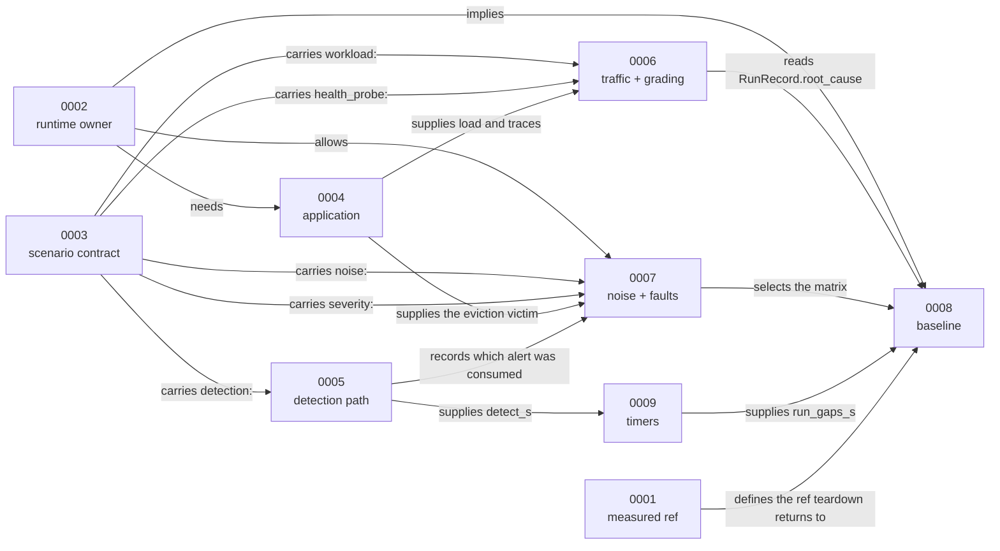

# Thesis ADRs

Decision records for this fork's evaluation work. Upstream decisions live in
[`docs/adr/`](../../adr/); this directory holds the choices made *for the this work*, so the two sets
stay separable when the fork is diffed against upstream.

Format follows the upstream ADRs: `status`, `date`, `decision-makers`, then Context, Decision
Drivers, Considered Options, Decision Outcome, Consequences, Confirmation, and Pros and Cons per
option. Every record states a **Validation Status**, because most of these were taken by reading code
and have not yet been exercised against the cluster.

## Index

| ADR | Decision | Status |
| --- | --- | --- |
| [0001](0001-measurement-base-and-ref-selection.md) | Measurement base is upstream `v2.0.0`; measured state is a `series_ref` input plus an annotated tag | Partially confirmed |
| [0002](0002-testbed-runtime-ownership.md) | vigil's harness owns the runtime; SREGym contributes knowledge only | Not started |
| [0003](0003-multi-fault-scenario-contract.md) | Additive `faults:` list, one generic `inject.sh`, plus per-fault `health_probe` and `severity` | Partially confirmed |
| [0004](0004-application-under-test.md) | `astronomy-shop` from upstream; `vigil-app` as control; Podinfo as Flux smoke test | Not started |
| [0005](0005-fault-detection-path.md) | Real `PrometheusRule`s primary, synthetic payload as a recorded fallback, poller off | Not started |
| [0006](0006-traffic-and-grading.md) | Locust for realism plus stepped rate for precision; probes for state, rules for mechanics, the pinned judge for semantics | Not started |
| [0007](0007-noise-and-fault-selection.md) | Noise as an on/off factor on SREGym's schedule, without Chaos Mesh; port three OS faults, one of which is cleaner on NixOS | Not started |
| [0008](0008-zero-change-baseline.md) | One output-only `RunRecord` patch; teardown by branch reset; characterise the baseline by observation, not from code | Not started |
| [0009](0009-latency-instrumentation.md) | Derive timings in `eval/`; add no timers to vigil; `gate` and `reconcile` are mandatory | Partially confirmed |

## How the decisions depend on each other

## Conventions

- One decision per record. Where a record has two headings under Decision Outcome, they were taken
  together and appear as one index entry
- Cite file paths, not symbols alone, so a reader can find the code
- Record what was rejected and why; a decision without alternatives is a preference
- `Validation Status` is honest: "Not started" is normal here
- ADR numbers are stable. A merged record takes the slot its subject already occupied in the
  reading order, and old numbers are recorded above and never reused
